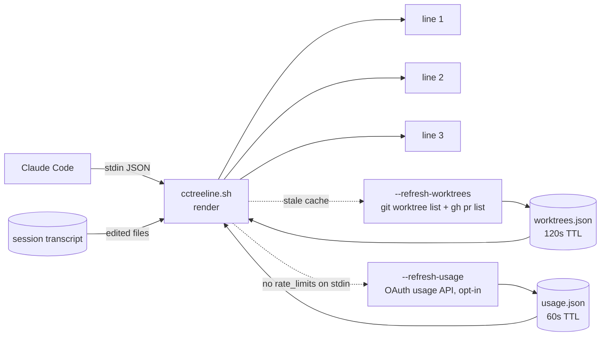

<div align="center">

# cctreeline

**A Claude Code statusline for people who work in several git worktrees at once.**

See which of your worktrees have open PRs, scoped to the ones you touched this session.

[](LICENSE)
[](https://github.com/jhlee0409/cctreeline/actions/workflows/shellcheck.yml)


</div>

## Quick start

```bash
git clone https://github.com/jhlee0409/cctreeline
cd cctreeline && bash install.sh
```

Restart Claude Code, or send any message, and the statusline appears below your prompt. You need `bash`, `jq` and `git`; `gh` adds PR numbers.

## What you get

```
12m · myapp · main ⌂main ●2 +1 · Opus 5.5 1M · id:a1b2c3d4-e5f678
ctx ███░░░░░░░ 31% · 7d █████░░░░░ 58% 2d2h · 5h-42% 3h11m
⎇ feature-auth      PR: #142
⎇ hotfix-payments   PR: #143 #144
```

| Line | Shows | Source |
|---|---|---|
| **1 · where you are** | session time · repo-relative path · branch + worktree badge (`⌂main` or `⎇wt(parent)`) + dirty marks (`●` modified, `+` staged, `↑` ahead) · model + `1M` badge · session id | stdin + `git` |
| **2 · how much is left** | context gauge · weekly limit · 5-hour limit, each with a reset countdown. Turns orange at 60% and red at 80% | stdin (`context_window`, `rate_limits`) |
| **3 · what's in flight** | open PR numbers for each linked worktree **you edited in this session** | `git worktree list` + `gh pr list`, filtered by this session's transcript |

Line 3 is the reason cctreeline exists. If you run one worktree per task and switch between Claude sessions, it shows which branches have PRs and which ones you just touched. With a single worktree you don't need it; a general-purpose statusline will serve you better.

## Why cctreeline

- **It does one thing the others don't.** It joins worktree (main or linked, plus its parent repo), open PR number, and the files you edited this session. [ccstatusline](https://github.com/sirmalloc/ccstatusline), [claude-hud](https://github.com/jarrodwatts/claude-hud) and [claude-powerline](https://github.com/Owloops/claude-powerline) are broader, with themes, many widgets and a config TUI. cctreeline doesn't compete on that.
- **It uses what Claude Code already sends.** Since Claude Code 2.1, the statusline gets context %, window size and your 5h/weekly limits on stdin. cctreeline reads them directly, so it needs no credentials and makes no API call to draw the gauges.
- **No package manager in the hot path.** It's pure `bash` + `jq`, with no `npx … @latest` on every frame. The render reads stdin and local cache files and never touches the network.
- **Portable.** Works with bash 3.2 (stock macOS) and GNU or BSD `date`/`stat`, and keeps its files in XDG paths. CI runs shellcheck plus render tests against a recorded Claude Code payload.

## Install

```bash
bash install.sh                 # interactive: detects your setup, asks up to 4 questions
bash install.sh --defaults      # non-interactive (dotfiles / CI): safe defaults, no credential reading
```

The installer detects your OS, `date` flavor, credential store and dependencies. It backs up `settings.json` and asks before replacing an existing statusline. The questions:

1. **Usage-API fallback?** Only for Claude Code builds that don't send `rate_limits` on stdin. It reads your Claude credentials and calls `api.anthropic.com`. It is off under `--defaults` unless you pass `--enable-usage`.
2. **Worktree + PR line?** Needs `gh` for PR numbers.
3. **ASCII glyphs?** For terminals without box-drawing fonts.
4. **Compact line 2?** Shows only `ctx` + `5h`.

<details>
<summary>Manual install</summary>

```jsonc
// ~/.claude/settings.json
{ "statusLine": { "type": "command", "command": "bash /path/to/cctreeline.sh" } }
```

Optional: install coreutils (`timeout`, or `gtimeout` on macOS via `brew install coreutils`) to put a time limit on the background `gh` call.
</details>

## Configuration

`${XDG_CONFIG_HOME:-~/.config}/cctreeline/config` holds shell `key=value` lines:

| Key | Values | Default | Meaning |
|---|---|---|---|
| `CCTREELINE_WORKTREE_LINE` | `1` / `0` / `auto` | `auto` | Line 3 (`auto` turns it on inside a git repo) |
| `CCTREELINE_DENSITY` | `full` / `compact` | `full` | `compact` shows only ctx + 5h on line 2 |
| `CCTREELINE_COLOR` | `auto` / `256` / `none` | `auto` | `auto` honors `NO_COLOR` and `TERM=dumb` |
| `CCTREELINE_GLYPHS` | `unicode` / `ascii` | `unicode` | Glyph set |
| `CCTREELINE_USAGE_GAUGES` | `1` / `0` | `1` | Usage-API fallback (reads credentials) when stdin has no `rate_limits`. Stdin gauges show either way |
| `CCTREELINE_REUSE_HUD_CACHE` | `auto` / `0` | `auto` | Fallback only: reuse claude-hud's usage cache instead of calling the API a second time |

## How it works



- **Render** (`cctreeline.sh`, no args) reads only stdin and cache files, so it is fast and works offline.
- **Line 2** comes from `context_window.used_percentage`, `context_window.context_window_size` (which sets the `1M` badge) and `rate_limits.five_hour` / `seven_day`. On older builds it falls back to transcript token counts and the usage API.
- **Line 3** comes from a cached worktree/PR list, refreshed in the background by a single locked job, and filtered to the paths that `Edit` / `Write` / `MultiEdit` / `NotebookEdit` touched in this session's transcript.

### What it reads and sends

| | Reads | Network |
|---|---|---|
| Render | stdin JSON, your session transcript, local caches, `git` | none |
| Worktree refresh | `git worktree list` | `gh pr list` (your existing `gh` auth) |
| Usage fallback *(opt-in)* | Claude OAuth token (Keychain or `~/.claude/.credentials.json`) | `api.anthropic.com/api/oauth/usage`; the token goes via curl stdin, never argv |

## Troubleshooting

<details>
<summary>No 5h / 7d gauge</summary>

Claude Code includes `rate_limits` only for claude.ai Pro/Max subscribers, and only after the session's first API response. Each window can be missing on its own. A missing window is not drawn.
</details>

<details>
<summary>Line 3 is missing</summary>

Line 3 lists only **linked** worktrees (not the main checkout) whose files you **edited in this session**. Check `git worktree list`, then edit a file in one of them. PR numbers need `gh auth status` to succeed in that repo. The cache refreshes every 2 minutes.
</details>

<details>
<summary>Statusline is blank or broken</summary>

Run it by hand with a sample payload:

```bash
echo '{"workspace":{"current_dir":"'"$PWD"'"},"model":{"display_name":"Opus 5.5"},"context_window":{"used_percentage":12,"context_window_size":1000000}}' \
  | bash ~/.local/share/cctreeline/cctreeline.sh
```

Garbled glyphs: set `CCTREELINE_GLYPHS=ascii`.
</details>

## Limitations

- **No cost display, themes or config TUI**, by design. Use ccstatusline or claude-powerline if you want those.
- **The per-model weekly tag** (`7d·Opus`) exists only on the usage-API fallback, and only when that undocumented endpoint returns a `limits[]` array. The stdin path shows a plain `7d`.

## Uninstall

<details>
<summary>Remove cctreeline completely</summary>

```bash
# 1. restore your statusline from the timestamped backup the installer made…
ls ~/.claude/settings.json.cctreeline-bak.*        # pick the right one
cp ~/.claude/settings.json.cctreeline-bak.<epoch> ~/.claude/settings.json
#    …or, if cctreeline was your only statusline, drop the key:
#    jq 'del(.statusLine)' ~/.claude/settings.json | sponge ~/.claude/settings.json

# 2. remove the runtime, config, and cache (respect XDG_*/CLAUDE_CONFIG_DIR if you set them)
rm -rf "${XDG_DATA_HOME:-$HOME/.local/share}/cctreeline" \
       "${XDG_CONFIG_HOME:-$HOME/.config}/cctreeline" \
       "${XDG_CACHE_HOME:-$HOME/.cache}/cctreeline"
```
</details>

## Contributing

Issues and PRs are welcome. See [CONTRIBUTING.md](CONTRIBUTING.md). Before opening a PR, run `shellcheck cctreeline.sh install.sh && bash tests/render_test.sh`. Report security issues as described in [SECURITY.md](SECURITY.md).

## Acknowledgements

The usage-API fallback follows the OAuth-usage approach of [claude-hud](https://github.com/jarrodwatts/claude-hud) (MIT, by Jarrod Watts) and can reuse its cache. Thanks also to [ccstatusline](https://github.com/sirmalloc/ccstatusline) and [claude-powerline](https://github.com/Owloops/claude-powerline) for charting the Claude Code statusline space.

## License

MIT. See [LICENSE](LICENSE).
